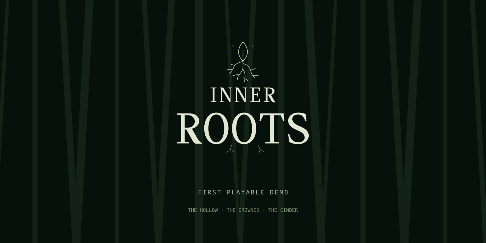

# Inner Roots — Gameplay Demo v1.3

**[Play in your browser](https://leolunelove.github.io/inner-roots/)** · [Download demo v1.0](https://github.com/leolunelove/inner-roots/releases/tag/v1.0.0-demo.1)

A quiet first-person exploration game about finding your way through a living forest. Your flashlight barely reaches the next turn. Send a pulse through the buried roots: veins wake unevenly, trees contract, and a thick black film drains away before slowly crawling back.

**Three larger, varied mazes. Nine signals. One demo ending.** All three mazes are selectable from the centred main menu, or playable in sequence. Cleared groves and best times are saved on your device.

| Maze | Environment |
| --- | --- |
| The Hollow | Old-growth trees, leafy hedge lanes, mossy glades and warm root light |
| The Drowned | Flooded glades, tight hedge passages, pale trunks and cyan veins |
| The Cinder | The largest maze: charred trees, tangled thickets and ember light |

The Hollow, Drowned and Cinder now use 6×6, 7×7 and 8×8 room layouts. Trails taper between approximately 1.5 and 3.6 metres wide, opening into larger glades. Dense hedges alternate with tree-lined earth banks, and the field map follows the actual trail shapes. Best times start fresh for these larger layouts.

## Cinematic interface and living places · v1.3

A centered cinematic chapter menu, readable text-led actions, quieter HUD and full-screen field atlas now share one visual language. The atlas charts the actual winding trails, canopy and reed symbols, landmarks and walking breadcrumbs. It supports zoom buttons, wheel zoom and + / − / 0 keyboard controls; unseen routes remain hidden. Menu and overlay controls support keyboard focus.

The three areas span approximately 48, 56 and 63 metres. Trails now bend between junctions, with a few deliberate reconnecting routes alongside dead ends and open glades. Hollow gains root cairns, a broken elder stump, listening stones, fallen timber, fungi and ferns. Drowned gains sunken flood walls, old mooring posts, wetland markers and gently moving reeds. Cinder gains split burned crowns, charcoal branches and ash-stone rings. Large props stay outside the walking boundary.

Returning to the menu or restarting reuses the existing world. Chapter changes show a themed loading transition. Shared tree/depth materials and stable light counts reduce shader churn, while new environmental detail uses less than 0.5 MiB of geometry/instance buffers per grove. Because reconnecting trails change routes and travel times, v1.3 keeps a new set of completion records; earlier records are left untouched in local storage.

## Visual update · v1.2

The forest now has leaning, asymmetrical trees with connected forked crowns and grounded buttress roots, lower rolling banks, layered hedge foliage and more varied wet-soil shading. Signals are warm seeds held in broken stone; the exit is a crooked root-bound timber arch with a drifting veil. The centered menu, grove illustrations, HUD, field map, instructions and interludes share a refined botanical treatment. The slow pulse and liquid return retain their existing gameplay timing, and v1.1 records remain compatible.

## Play locally

No installation or build is required. Serve the `dist/` folder with Python 3:

```sh
python3 -m http.server 5173 --directory dist
```

Open **http://localhost:5173**. A WebGL 2 capable browser is required. Use a desktop browser for the full mouse-and-keyboard experience. The vendored engine, materials, logo and synthesized sound work locally; Google Fonts are optional and have system fallbacks.

## Controls

| Input | Action |
| --- | --- |
| W A S D | Walk and strafe |
| Mouse | Look without holding a button |
| Left click / Space | Send a root pulse |
| Shift | Run |
| M | Open the explored field map |
| Escape | Pause and release the mouse |
| Arrow keys / Q E | Alternative movement and turning |

Recover three root-bound signal stones in each grove, then enter its crooked timber arch. The pulse recharges in fourteen seconds, allowing the slow liquid return to finish. Toggle **SOUND ON** for quiet directional creaks, root cracks and wet crawling textures. There are no enemies, jump scares or time limits. Touch controls are available; physical-phone testing remains limited.

Native Pointer Lock is requested on entry and resume. Embedded browsers that refuse it use continuous no-hold mouse look, including turning at the window edges. Refreshing resets the current run; completed groves and best times persist locally.

## Verification

```sh
node verify.mjs
node verify-nerves.mjs
node verify-audio.mjs
node verify-demo.mjs
node verify-space.mjs
```

The original v1.0 demo was played through in a real browser using keyboard movement: all nine signals collected, all three gates completed, transitions and the final ending displayed, and saved completion marks survived reload. The centred menu and instructions were reviewed at desktop size and 390 × 844. Shader and console checks passed. Native Pointer Lock in a supporting desktop browser and physical touch hardware still need hands-on checks.

For v1.1, the expanded Hollow was completed with keyboard movement in the browser. The Drowned and Cinder environments, pulses, map and grove switching were reviewed in Safari. Chromium graphics contexts became unavailable during this session, including for the unchanged v1.0 baseline; a full v1.1 Chromium rerun remains outstanding. The spatial suite checks 75 larger layouts and 351,124 body-route samples, including narrow turns, clearing edges, blocked wall centres and spatial-index agreement.

For v1.2, the new menu, HUD, Hollow forest, root pulse, field map, pause and signal collection were reviewed in real Safari/Chrome sessions. Later review encountered graphics-context failures affecting both the local revision and unchanged live v1.1; final Drowned/Cinder rendering, mobile layout and a complete three-grove rerun remain outstanding. Geometry and landmark checks passed for all three themes. Fern/litter instancing reduced Hollow geometry buffers from 126 to 26 MiB and Drowned from 71 to 27 MiB during comparison with the initial visual revision.

For v1.3, the Hollow menu, walking, pulse, pause and explored atlas/zoom were exercised in the real browser before graphics failure interrupted the Drowned review. The UI and atlas were additionally rendered in an isolated layout fixture at 1280 × 720 and 390 × 844 without horizontal overflow; that fixture does not verify 3D rendering. All three new area-detail sets passed finite-geometry, landmark and route-clearance checks. Four sequential construction checks confirmed stable pooled tree/depth material identities with current theme colours and tree IDs.

The browser later failed to create graphics contexts for both the local revision and unchanged live v1.2. The final Drowned/Cinder visuals and full three-grove playthrough remain unverified in this session. Resource reuse and graceful graphics-error handling are implemented, but the underlying browser graphics failure is not claimed resolved.

The current route suite covers 300 generated mazes and 320,670 collision/collection samples. The spatial suite covers 75 varied layouts and 286,426 full-body samples, reconnecting cycles, curved trail geometry, clearings and wall integrity. Additional checks cover propagation, monotonic surges, quiet PCM textures, silent boundaries and visual/audio timing. Serve the project root and open `qa/audio.html` to render the actual sound graph offline and check stereo, headroom, mute, pause and resume. Digital output was verified; physical-headphone listening has not been reviewed.

## Source and credits

Built with vendored **Three.js 0.181.1**. Its MIT license is included in `dist/vendor/THREE-LICENSE.txt`.

Game, original vector logo, procedural environments and synthesized sound: **Leo Lune**. The included photographic material atlas was generated for this project; its prompt and development notes are in [the development history](docs/DEVELOPMENT_HISTORY.md). No reference video frames or creator assets are included.

Visual inspiration: the forest-light study by **011 / @nomoreluca**, [shared by Three.js](https://x.com/threejs/status/2123549786272100698). This demo is an original interpretation.

This is gameplay demo version `1.3.0-demo.1`. Original project code and assets carry no additional license grant; the third-party Three.js license remains applicable to its files.
